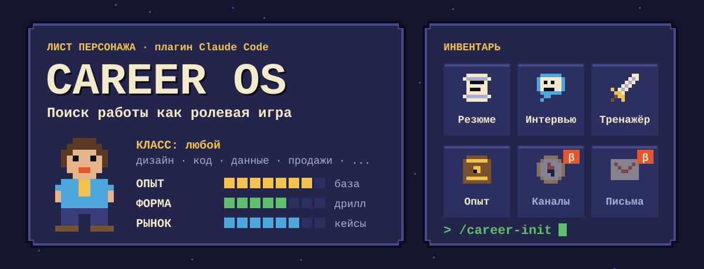
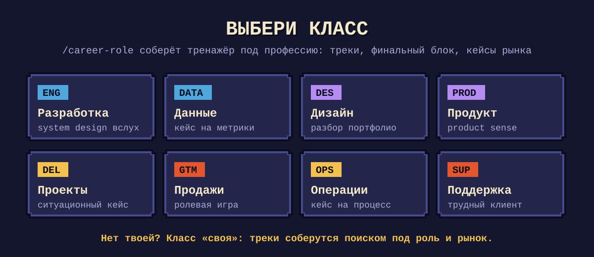
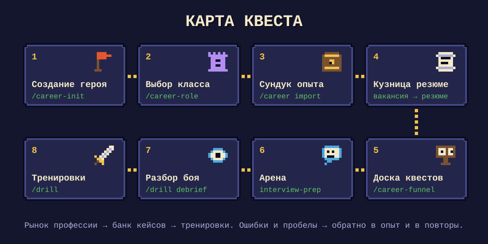

<p align="center">
  
</p>

Career OS ведёт поиск работы целиком прямо в Claude Code. Ты один раз записываешь свой опыт, и из него собираются резюме под вакансию, подготовка к интервью и ежедневная тренировка. Тренировка идёт на ситуациях, о которых люди твоей профессии пишут прямо сейчас.

Профессия может быть любой. Дизайнер тренирует разбор портфолио и дизайн-челленджи, разработчик тренирует system design и разбор инцидентов, продажник отрабатывает звонки с возражениями.

<p align="center">
  
</p>

## Зачем это, если есть чат

В обычном чате ты пересказываешь опыт, получаешь текст, через неделю пересказываешь заново, и каждый раз чуть другими словами. На интервью выясняется, что в резюме написано одно, а рассказываешь ты другое.

Здесь опыт записан один раз: блоками, с метриками и с пометкой, чем каждую цифру можно подтвердить. Скиллы собирают из блоков то, что нужно под вакансию, и не придумывают того, чего в базе нет.

Тренажёр тоже не придумывает кейсы. Скрипт собирает посты из сабреддитов, Telegram-каналов и Stack Exchange твоей профессии. Из них берутся настоящие ситуации с развилкой, только домен и цифры подменяются, чтобы ты решал задачу, а не узнавал историю.

## Установка

```
/plugin marketplace add kaspruknikita-tech/career-os
/plugin install career-os
```

Или вручную:

```
git clone https://github.com/kaspruknikita-tech/career-os.git
cp -R career-os/skills/* ~/.claude/skills/
cp career-os/commands/* ~/.claude/commands/
```

При ручной установке мастер спросит путь к склонированной папке. Нужен Python 3: на нём работают сборщик кейсов и выгрузка в Word.

## Первый запуск

```
/career-init                      создать базу, заполнить ядро, настроить под профессию
/career import <файл>             разложить старое резюме или перформанс-ревью на блоки
вот вакансия [текст], оцени фит   первая проверка, что всё работает
/drill                            первая тренировка
```

`/career-init` задаёт вопросы по одному, минут двадцать, потом вызывает `/career-role`: тот находит, как нанимают на твою роль, и собирает треки тренажёра, банки вопросов и источники кейсов.

## Инвентарь

| Предмет | Скилл или команда | Что делает |
|---|---|---|
| Резюме | `resume-tailor` | ATS-оценка вакансии, резюме из блоков под её требования |
| Интервью | `interview-prep` | Вероятные вопросы с рынка, блок на каждый этап найма твоей роли |
| Тренажёр | `daily-drill`, `/drill` | Кейс на время, разбор по тактам, повтор ошибок, разбор реальных интервью |
| Опыт | `career-data-keeper`, `/career` | Единственный, кто пишет в базу: блоки из документов, закрытие пробелов |
| Класс | `/career-role` | Профиль роли: этапы найма, треки, темы спринтов, источники рынка |
| Доска квестов | `/career-funnel` | Воронка откликов: какие каналы и версии резюме дают ответы |
| Каналы · бета | `channel-finder` | Рекрутеры, почты, LinkedIn, Telegram компании |
| Письма · бета | `cover-letter` | Сопроводительное на 120-180 слов с метриками из базы |

**Каналы и письма пока на доработке:** они работают, но заметно слабее остальной системы, поэтому их результат стоит проверять руками.

Ещё `/career-help` подскажет следующий шаг, `/career-map` покажет схему связей, `/career-feedback` отправит отзыв.

<p align="center">
  
</p>

## Как устроено

```
<база>/
├── role.md          профессия: треки, этапы найма, домены для подмены
├── career-data/     опыт: ядро, индекс, блоки, пробелы
├── drill/           тренажёр: журнал, ошибки, очередь повторов
│   └── market/      банки вопросов, сигналы вакансий, рынок (field/)
├── pipeline.md      воронка откликов
├── reference/       правила формата резюме, стратегии, площадки
├── scripts/         сборщик рынка, выгрузка в Word, распознавание речи
└── output/          результаты откликов, создаётся сам
```

Всё держится на трёх правилах.

1. В скиллах нет ни твоих фактов, ни твоей профессии, только процесс. Опыт лежит в `career-data/`, а профессия в `role.md`. Поэтому один и тот же набор работает и у дизайнера, и у бэкенд-разработчика.
2. В базу опыта пишет только `career-data-keeper`, остальные её читают. Без этого через месяц в базе окажутся три версии одного кейса, и уже не поймёшь, какая настоящая.
3. Каждый отклик оставляет след: требование без блока попадает в пробелы, тема из вакансии добавляет строку в сигналы рынка, провал на тренировке поднимает счётчик в индексе ошибок, а отправка и ответ двигают воронку. Если тема всплыла трижды, дело в рынке, а не в тебе: её либо оформляют блоком, либо учат.

## Тренажёр

Сессия занимает 45-60 минут. Сначала ты решаешь основной кейс по треку из `role.md`, потом проходишь финальный блок из трёх микрокейсов по 40 секунд, где засчитывается только итоговая фраза, а если подошла очередь, в конце повторяешь старые провалы.

Источник кейса выбирается по порядку: банк семян с рынка, банки вопросов, и только потом свой опыт, не чаще раза в три сессии. Пополнить банк:

```
/drill seeds
```

Сборщик `scripts/field.py` работает на стандартной библиотеке Python, читает только публичные страницы, и его можно поставить на еженедельное расписание.

Ещё режимы: `/drill debrief <транскрипт>` разбирает реальное интервью, `/drill stats` показывает тренд, `/drill sprint` даёт две недели на тему, которую рынок спрашивает, а ответить пока нечем.

## Экономия контекста

База растёт, а стоимость запроса нет. Скилл читает ядро и индекс, относит вакансию к архетипу и подтягивает только нужные блоки, обычно от 8 до 14. Сырые посты рынка Claude не читает вовсе: скрипт сам делает выжимку.

## Где лежат данные

Скилл ищет `career-data/` вверх по дереву от текущей папки, а если не находит, берёт путь из `~/.claude/career-os/config.json`. Когда базы нет и там, он предлагает `/career-init`. Подробности в [docs/resolver.md](docs/resolver.md).

## Правила, зашитые в систему

- Метрики берутся только из ядра. Их нельзя придумывать, округлять в свою пользу или переносить между компаниями.
- Кейс тренажёра всегда в чужом домене и с перечнем заданных фактов. Претензия к ответу, которая опирается на факт вне перечня, снимается.
- Блоки опыта не меняются при адаптации: каждая версия под вакансию пишется в `output/` вместе с changelog и не становится новым источником истины.
- Контакт рекрутера записывается только вместе со ссылкой, где он найден.
- Пост из сети попадает в банк только как механика ситуации, без имён и ников, со ссылкой.

## Проверка и отзыв

Если пробуешь систему одним из первых, пройди чек-лист из [TESTING.md](TESTING.md). Нужен примерно час, старое резюме и одна живая вакансия.

Отзыв отправляется командой `/career-feedback`. Она соберёт, что происходило, задаст три вопроса, уберёт личное и после твоего «да» создаст issue. Без Claude можно заполнить [форму](https://github.com/kaspruknikita-tech/career-os/issues/new?template=feedback.yml).

Список изменений версии 2.0 лежит в [CHANGELOG.md](CHANGELOG.md).

## Лицензия

MIT.
